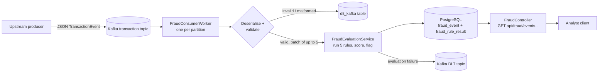

# Fraud Detection PoC – Solution Overview

This document explains the C# solution that implements the brief:

> Create a system that processes categorized transaction events and flags potential fraud. Apply a set of fraud rules per transaction based on different criteria and then store them in a data store. Allow the retrieval of this data via an API.

It is written from the code as it stands. Where something was not verified by running it, that is stated.

---

## 1. At a glance

| Brief requirement | How the solution meets it |
|---|---|
| Process categorized transaction events | Consumes JSON `TransactionEvent` messages from a Kafka topic, in batches, using a background worker per partition. Events are validated before scoring. |
| Apply fraud rules per transaction | Five configurable `IFraudRule` implementations are evaluated against every transaction. Each rule contributes a weighted score. |
| Flag potential fraud | A transaction is flagged when the capped, summed score reaches `FlagThreshold` (default 40). The triggered rule codes are stored as the reason. |
| Store the results | PostgreSQL. Each transaction is written to `fraud_event`, with one row per rule in `fraud_rule_result`, inside one DB transaction. |
| Retrieve via an API | ASP.NET Core REST API under `api/fraud`, JWT-protected, with filtering and paging. |

Technology: .NET 10 (`net10.0`), ASP.NET Core, Confluent.Kafka 2.16.0, Npgsql 10.0.3 (raw SQL and stored procedures), Polly resilience pipelines, Serilog, Swashbuckle (Swagger), xUnit.

---

## 2. Solution structure

The solution is four projects plus three test projects.

| Project | Role | Key contents |
|---|---|---|
| `fraud_poc_project_buss` | Business logic and shared models. | Fraud rules (`FraudRules.cs`), scoring (`Service/FraudEvaluationService.cs`), event validation (`Helper/TransactionEventValidator.cs`), DTOs (`Dto/`), settings classes (`Models/Settings/`). |
| `fraud_poc_project_repo` | Data access and Kafka producer. | `FraudRepository.cs` (Npgsql calls to stored procedures and functions), `Kafka/FraudProducer.cs` (produces to topics, including the dead-letter topic), `Connection/DBConnection.cs`. |
| `fraud_poc_project_ui` | Host: the ASP.NET Core API, the Kafka consumer, auth, metrics, health checks, DB migration scripts. | `Program.cs`, `Controllers/`, `Kafka/Consumer/`, `Services/`, `Middleware/`, `database/` (versioned SQL scripts). |
| `fraud_poc_project_buss` dependencies | — | Referenced by both `repo` and `ui`. |
| `tests/fraud_poc_project_buss.Tests` | Unit tests for rules, scoring, validation. | One test class per rule. |
| `tests/fraud_poc_project_repo.Tests` | Repository tests. | `FraudRepositoryTests.cs`. |
| `tests/fraud_poc_project.Tests` | API, controller, metrics, integration, load and stress tests. | `Integration/`, `LoadTests/`, `StressTests/`. |

Dependency direction: `ui` → `repo` → `buss`. `buss` depends on nothing in the solution, so the rules can be unit-tested without Kafka or a database.

---

## 3. End-to-end flow

Step by step:

1. **Ingest.** `FraudConsumer` (a `BackgroundService`) starts one `FraudConsumerWorker` per partition of the transaction topic. The partition count is read from `KafkaAdminOptions:TopicOptions`. Each worker uses a Kafka consumer group with `EnableAutoCommit = false`.
2. **Batch.** Messages accumulate until one of three triggers fires: batch size reached (`BatchSize`, 5 in the RELEASE/Test config), batch timeout (`BatchProcessTimeout`, 5 s), or partition EOF.
3. **Deserialise and validate.** Each message is parsed with Newtonsoft. `TransactionEventValidator` then checks it (section 5.1). Bad messages are written to the `dlt_kafka` table and skipped. They are never scored or persisted.
4. **Evaluate.** `FraudEvaluationService.Evaluate` runs every registered `IFraudRule` and computes the score and flag (section 4).
5. **Persist.** `FraudRepository.SaveFraudEvaluationAsync` calls `sp_insert_fraud_event`, then `sp_insert_fraud_rule_result` once per rule, in a single database transaction. The write is wrapped in a Polly retry pipeline (`"exception"`).
6. **Commit.** After the batch is handled, offsets are committed manually for each partition in the batch (last processed offset + 1). Dead-lettered messages count as processed.
7. **Failure handling.**
   - Evaluation failure (`FraudEvaluationException`) → sent to the Kafka dead-letter topic (`TransactionTopicDtl`, `poc-fraud-dev-dtl` in config), falling back to `dlt_kafka` if that also fails.
   - Database failure → recorded in `dlt_kafka`.
   - Any other error → the worker fails, and `FraudConsumer` restarts it up to `StartWorkerRetry` times (2 in config) from the last committed offset.
8. **Query.** Analysts query the stored results through the REST API (section 6).

---

## 4. Fraud rules and scoring

### 4.1 The five rules

All rules implement `IFraudRule` (`RuleCode`, `RuleDescription`, `Evaluate(TransactionEvent)`) and read their own settings block from the `FraudRules` configuration section. Each rule has an `Enabled` switch. A disabled rule still produces a result row, with `IsTriggered = false`, `ScoreContribution = 0` and the description "Rule disabled", so every stored event has one result per rule.

| Rule code | What it detects | Trigger condition | Default settings | Default score |
|---|---|---|---|---|
| `HIGH_AMOUNT` | Unusually large transaction | `abs(Amount) > Threshold` | Threshold 50 000 | 40 |
| `FOREIGN_CNP` | Card-not-present purchase from abroad | (`TransactionType` = `CNP` or `Channel` = `Online`) AND `CountryCode` is set and differs from `HomeCountry` | HomeCountry `ZA` | 35 |
| `ATM_WITHDRAWAL_LIMIT` | ATM cash withdrawal above the single-transaction limit | (`TransactionType` = `ATM` or `Channel` = `ATM`) AND `abs(Amount) > Limit` | Limit 5 000 | 30 |
| `ROUND_AMOUNT` | Large round-number amount, a common fraud pattern | `abs(Amount) >= MinimumAmount` AND `abs(Amount) % RoundnessMultiple == 0` | Minimum 1 000, multiple 1 000 | 10 |
| `HIGH_RISK_MERCHANT` | Purchase in a high-risk merchant category | `MerchantCategory` is in the configured list (case-insensitive) | `gambling, casino, crypto, cryptocurrency, money_transfer, wire_transfer` | 25 |

Notes on the rules:
- Amount comparisons use `Math.Abs`, so reversals and negative amounts are treated the same as debits.
- Category and country matching is case-insensitive. A missing `CountryCode` or `MerchantCategory` never triggers a rule.
- `HighRiskCategories` is a comma-separated string, parsed into a case-insensitive set.

### 4.2 Scoring and flagging (`FraudEvaluationService`)

1. Every rule is evaluated, triggered or not.
2. `FraudScore` = sum of `ScoreContribution` for triggered rules, capped at `MaxScore` (100).
3. `IsFlagged` = `FraudScore >= FlagThreshold` (40).
4. `FlaggedReason` = comma-separated codes of the triggered rules, only when flagged.

What this means in practice with default settings:

| Combination | Score | Flagged? |
|---|---|---|
| `HIGH_AMOUNT` alone | 40 | Yes |
| `FOREIGN_CNP` alone, or `ATM_WITHDRAWAL_LIMIT` alone | 35 / 30 | No |
| `FOREIGN_CNP` + `ROUND_AMOUNT` | 45 | Yes |
| `FOREIGN_CNP` + `ATM_WITHDRAWAL_LIMIT` | 65 | Yes |
| `HIGH_RISK_MERCHANT` + `ROUND_AMOUNT` | 35 | No |
| All five rules | 140, capped to 100 | Yes |

The sum of the default contributions is 140, so the 100 cap takes effect when most rules fire together.

All weights, the threshold, the cap and the rule settings live in `appsettings*.json` under `FraudRules`. Changing a rule does not need a code change, but adding a new rule does (a new class implementing `IFraudRule`, registered in DI).

---

## 5. Data handling

### 5.1 Validation (`TransactionEventValidator`)

Runs before scoring. Every failure is collected and the event is dead-lettered with the full list of errors.

- `TransactionId` must not be empty.
- `CustomerId` and `AccountId` are required, max 100 characters.
- `Amount` must be non-zero and within ±1 trillion (fits `NUMERIC(18,2)` with headroom).
- `Currency` must be a 3-letter uppercase ISO code.
- `TransactionType` is required and must be one of `POS`, `ATM`, `EFT`, `CNP`.
- Length limits: `Channel` 50, `CountryCode` 10, `MerchantCategory` 100, `MerchantName` 250.
- `TransactionTime` is required and must not be more than 5 minutes in the future (clock-skew tolerance).
- Timestamps with no offset are treated as UTC before persisting. Npgsql rejects unspecified-kind values for `timestamptz`.

### 5.2 Database schema

Managed by versioned SQL scripts in `fraud_poc_project_ui/database/`. They run on every startup and are written to be re-runnable. The schema name comes from `Database:DBSchema` (default `fr`).

| Object | Purpose |
|---|---|
| `fraud_event` | One row per transaction: the event fields as consumed, plus `is_flagged`, `fraud_score` (NUMERIC(5,2)) and `flagged_reason`. `transaction_id` is unique. Indexed on `customer_id`, `transaction_time` and `is_flagged`. |
| `fraud_rule_result` | One row per (event, rule): `rule_code`, `rule_description`, `is_triggered`, `score_contribution`. Foreign key to `fraud_event` with cascade delete. Unique on (`fraud_event_id`, `rule_code`). |
| `dlt_kafka` | Dead-letter table for messages that could not be processed: raw payload, topic, error text (max 2 000 characters), timestamp. |
| `sp_insert_fraud_event` | Upsert on `transaction_id`. A redelivered event updates the evaluation fields rather than failing. Returns the new `id`. |
| `sp_insert_fraud_rule_result` | Upsert on (`fraud_event_id`, `rule_code`). |
| `sp_insert_dlt_error` | Writes to `dlt_kafka`. |
| `fn_select_fraud_events` | Filtered, paged query used by the events endpoint. |
| `fn_select_fraud_rule_results` | Rule results for one event. |

Idempotency: Kafka delivery is at-least-once, so the same transaction can arrive twice. The `transaction_id` upsert and the (event, rule) upsert make a redelivery overwrite the same rows instead of duplicating them. V1_0_7 also removes duplicates left by earlier versions before adding the unique constraint.

---

## 6. The API

Base path `api/fraud`. Swagger is served at `/swagger`. Outside the `loc` environment, Swagger UI only offers GET, POST and PUT as submit methods. The app listens on port 8083 outside `loc`.

| Method | Route | Auth | Purpose |
|---|---|---|---|
| POST | `/api/fraud/login` | Anonymous | Exchanges a username and password for a JWT (Bearer, default 60 minutes). Five failures lock the account for 15 minutes. Locked attempts return 429. |
| GET | `/api/fraud/events` | `Analyst` role | Lists stored fraud evaluations, with optional filters and paging. |
| GET | `/api/fraud/events/{fraudEventId}/rules` | `Analyst` role | Returns the per-rule results for one event. Returns 404 if the event does not exist. |

Filters on `GET /api/fraud/events` (all optional):

| Parameter | Type | Notes |
|---|---|---|
| `DateFrom`, `DateTo` | string | Format `yyyy-MM-dd HH:mm:ss`. Validated by regex. |
| `CustomerId` | string | Exact match. |
| `IsFlaggedOnly` | bool | `true` returns flagged events only. |
| `TransactionType` | string | e.g. `POS`, `ATM`, `EFT`, `CNP`. |
| `MinFraudScore` | decimal | Score at or above this value. |
| `Page` | int | 1-based, default 1. |
| `PageSize` | int | Default 50, max 500. |

Response shape: a list of `FraudEventRecord`, each with the transaction fields (`Event`), `IsFlagged`, `FraudScore`, `FlaggedReason` and `RuleResults`. Each rule result has `RuleCode`, `RuleDescription`, `IsTriggered` and `ScoreContribution`.

Other endpoints in the same host:
- `api/metrics/*` (Analyst): snapshot, summary, transactions, performance, per-rule stats, authentication, database, Kafka. `POST api/metrics/reset` clears them.
- `api/load/simulate` (Admin): runs a load simulation.
- Health checks (`ConfigureHealthChecks`), including a Kafka broker check and Kubernetes probes.

Cross-cutting concerns:
- **Correlation IDs** (`CorrelationIdMiddleware`, registered in `Program.cs`): reads or generates an `X-Correlation-ID` per HTTP request, echoes it in the response and adds it to the log scope. It applies to API requests only. Kafka processing uses the `CorrelationId` carried in the event payload instead.
- **XSS validation** (`CheckForXssMiddleware` and `[ValidateXss]` on controllers).
- **CORS** configured from `CorsSettings`.
- **Forwarded headers** are only trusted from configured `KnownProxies` (Traefik).
- **Secrets:** locally, `secrets.json` is loaded when the environment is `loc`. Otherwise configuration comes from the environment and AWS.

---

## 7. Configuration reference

| Section | Key settings (defaults from `appsettings.json`) |
|---|---|
| `FraudRules` | Per-rule thresholds, scores and `Enabled`; `FlagThreshold` 40; `MaxScore` 100. |
| `KafkaSettings` | Broker settings, topic and partition definitions (`TopicOptions`), `ConsumerSettings` (`TransactionTopic`, `BatchSize` 5, `BatchProcessTimeout` 5 s, `ConsumeMessageIntervalMs` 10, `StartWorkerRetry` 2), producer and idempotence settings. |
| `ConnectionStrings:PostgreSQL` | Database connection. |
| `Database:DBSchema` | Schema name, default `fr`. |
| `LoginSecuritySettings` | Max failed attempts 5, failure window 15 min, lockout 15 min, rate limit 10 per minute. |
| `ForwardedHeaders:KnownProxies` | Trusted proxy IPs. |

Environment-specific files exist for `RELEASE`, `Test`, `LOC`. The `ResiliencePipeLineSettings` section configures the Polly retry pipeline (`"exception"`) used around database writes and dead-letter production.

---

## 8. Observability

- **Logging:** Serilog to console and file. Sensitive payloads are logged through a dedicated `LogSensitiveData` helper. Repository errors log identifiers only (`CorrelationId`, `TransactionId`), not customer or amount data.
- **Metrics:** `MetricsService` (singleton) tracks per-rule trigger counts and timings, transaction counts and flagged counts, database and Kafka operation timings, and authentication attempts. These counters are held in memory, so each instance has its own. They are exposed through the `api/metrics` endpoints.
- **Health:** ASP.NET Core health checks, plus a Kafka broker check.

---

## 9. Testing

| Project | What it covers | Notes |
|---|---|---|
| `fraud_poc_project_buss.Tests` | Each rule's trigger and non-trigger cases, disabled-rule behaviour, scoring and cap, flag threshold, validator rules. | Pure unit tests, no infrastructure. |
| `fraud_poc_project_repo.Tests` | Repository behaviour. | |
| `fraud_poc_project.Tests` | Controller tests, API tests through a test fixture, business integration tests, metrics tests, login-attempt tracker tests, plus load and stress test classes.

Around 143 `[Fact]`/`[Theory]` attributes exist across the three projects.

---

## 10. Deployment

- **Local:** `docker-compose.traefik.postgresql.yml` brings up Traefik and PostgreSQL. Run the `fraud_poc_project` project with the `loc` environment.
- **Container:** `Dockerfile` builds the image. The `docker-publish.yml` workflow publishes it. `deploy-https.ps1` installs it into a local Kubernetes cluster (Rancher Desktop) over HTTPS.
- **Cloud/infra:** `Terraform Template/` and `charts/` (Helm). `deploy.yml` is the deployment workflow.
- **CI:** `ci.yml` runs the build and tests.

---

## 11. Observations for the team

These come from reading the code. They are not defects I confirmed by running it.

1. **Hard-coded demo credentials in `README.txt`.** The file lists a username and password for the login endpoint. If that password is live anywhere, it should be rotated and removed from the repo.
2. **Score cap vs. default weights.** The default contributions add to 140 against a cap of 100, so when several rules fire, their weights are compressed. This is probably intentional, but the team should confirm it.
3. **Per-instance state.** Metrics are in memory per instance.
4. **Sensitive logging.** `LogSensitiveData` writes full transaction results. Confirm it is disabled outside local and test environments.
5. **Rule description on disabled rules.** Disabled rules are stored with the description "Rule disabled", so the stored description does not say which rule it was. Only the code identifies it.

---

## 12. Glossary

- **Transaction event:** the JSON message on the Kafka topic (`TransactionEvent` record).
- **Fraud event:** the stored evaluation of one transaction (`fraud_event` row, `FraudEventRecord` in code).
- **Rule result:** one rule's outcome for one fraud event (`fraud_rule_result` row, `FraudRuleSetRecord`).
- **DLT (dead-letter):** where messages go when they cannot be processed. Either the dead-letter Kafka topic (`TransactionTopicDtl`) or the `dlt_kafka` table.
- **Flag:** the boolean outcome of `score >= FlagThreshold`.
